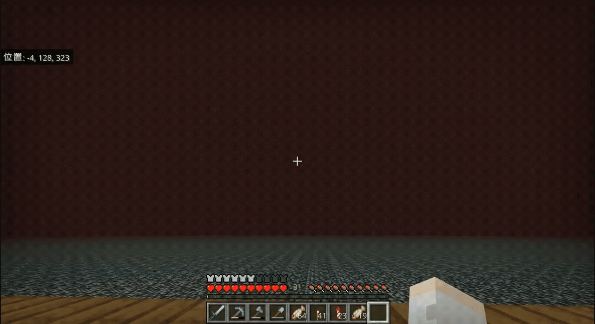
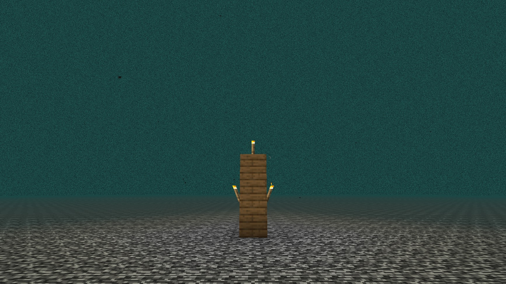

# GeyserSimpleNetherFogFix

> ⚠️ **【重要なお知らせ】**
> このコードは私自身の環境（個人用）に合わせて作成・テストしたものです。今後のアップデートや不具合報告・バグ修正への対応については、**気が向いたら対応するかもしれません**（基本は未定です）。あくまで「メモ・バックアップ」または「同様の機能を探している方向け」の現状渡しとしての公開となりますので、あらかじめご了承ください。

**GeyserSimpleNetherFogFix** は、Geyserの `nether-roof-workaround`を `true` にした際にネザー全体が同じ赤い霧になってしまう問題を解消し、**バイオームごとに異なる本来の霧（ネザーデフォルトの挙動）**を復元するためのシンプルなGeyser拡張プラグイン（Extension）です。



---

## ⚠️ 既知の不具合・制限事項（トレードオフ）

本プラグインを導入することでバイオームごとの霧や環境カラーが正常に表示されるようになりますが、**代償として以下の不具合（描画上の制限）が発生します。**

* **描写範囲外・奥の描画の乱れ（ガビガビ問題）**
  * ネザーの奥の方や描写範囲外が、ガビガビとした荒れた表示になってしまう現象が確認されています。
  * 特に**岩盤の上から上空を見上げたり、横方向の遠くを見渡したりした際**にこの状態が顕著に現めます。
* **作者による検証結果**
  * 私自身もテクスチャの調整など様々なアプローチでこの描画の乱れを修正できないか試みましたが、**現在のところ改善は不可能**でした。
  * GeyserおよびBedrock版クライアントのレンダリング仕様に起因するものと思われるため、この点をご理解・ご了承の上でご利用ください。



---

## 🧪 テスト環境

このプラグインは以下の環境で動作確認を行っています。

* **Velocity**: `velocity-4.2.0-30`
* **Geyser**: `2.12.1-b1302`
* **Paper**: `paper-1.21.10-127`(Geyser: `2.9.2-b1031`)

※これ以外の環境での動作保証は致しかねます。

---

## 💡 開発の経緯と設計のこだわり

ネザーの岩盤上に行けるようにするため Geyser のワークアラウンド機能を有効にすると、ネザー全体が一律の赤い霧で覆われてしまうのがどうしても気になっていました。同様の機能を持つプラグインを探したものの、「ネザーの霧の修正だけをシンプルに行うもの」が見つからなかったため、自作することにしました。

### 🚀 パフォーマンスとサーバー負荷への配慮
毎ティック（秒間20回）全員の状態を監視し続けるような重い処理は避け、サーバーのTPSに影響を与えないよう**軽量かつ効率的な設計**にこだわりました。
* **イベント駆動（遅延付き）**: ログイン時やネザーへのポータル移動直後など、クライアントの読み込みラグを考慮したミリ秒単位の遅延（設定可能）を挟んで確実に霧を削除します。
* **低頻度の定期チェック（保険）**: 一度霧が消えれば別のバイオームへ移動しても維持されるため、無駄な常時監視を行わず、数秒〜数十秒おきの低頻度な定期チェックで確実性を担保しています。

### 参考にさせていただいたプロジェクト
本プラグインは、素晴らしい拡張機能である [GeyserExtras](https://github.com/letsgoaway/GeyserExtras) （および派生エコシステム）のコードを解析し、ネザーの霧を修正する機能だけを抽出してシンプルにまとめたものです。
ベースとなる素晴らしいコードを公開してくださった開発者の皆様に深く感謝いたします。

### 🛠️ 処理の概要 ＆ 技術メモ
将来的にGeyserや依存関係のアップデートによって動作しなくなった際、ここを起点に元コードを追跡して修正するための技術メモです。

* **参照元**: `GeyserExtras 2.0.0-BETA-11`
* **対象ファイル**: `core/src/main/java/dev/letsgoaway/geyserextras/core/ExtrasPlayer.java`（216行目〜218行目）

該当する以下のコアロジックを抽出し、極限までシンプルにまとめています：

```java
if (session.getDimensionType().isNetherLike() && session.camera().fogEffects().contains(DimensionUtils.BEDROCK_FOG_HELL)) {
    session.camera().removeFog(DimensionUtils.BEDROCK_FOG_HELL);
}
```

---

## 📥 インストール方法
build フォルダ内にある GeyserSimpleNetherFogFix-x.x.x.jar をダウンロードします。

ダウンロードしたファイルを、Geyserのプラグイン（Extensions）フォルダ内に配置します。

サーバーを起動、またはGeyserをリロード（再起動）してください。

---

## 🤖 開発に関する注記
本プラグインのコード作成にあたっては、AI（Gemini）のサポートを受けています。私自身に簡単なプログラミングの知識はあるものの、ゼロからのコーディングは困難なため、AIの協力に感謝しています。

---

## 📢 公開の理由
「ネザーの岩盤上ビルドを有効にしたいけれど、あの赤い霧一色になるのだけはどうにかしたい……自分と同じように、シンプルにネザーの霧だけを修正できる機能を探している人に使ってほしい」という思い、そして自分自身の開発・保守用のメモとして公開に至りました。同じ悩みを持つサーバー管理者のお役に立てれば幸いです。

---
