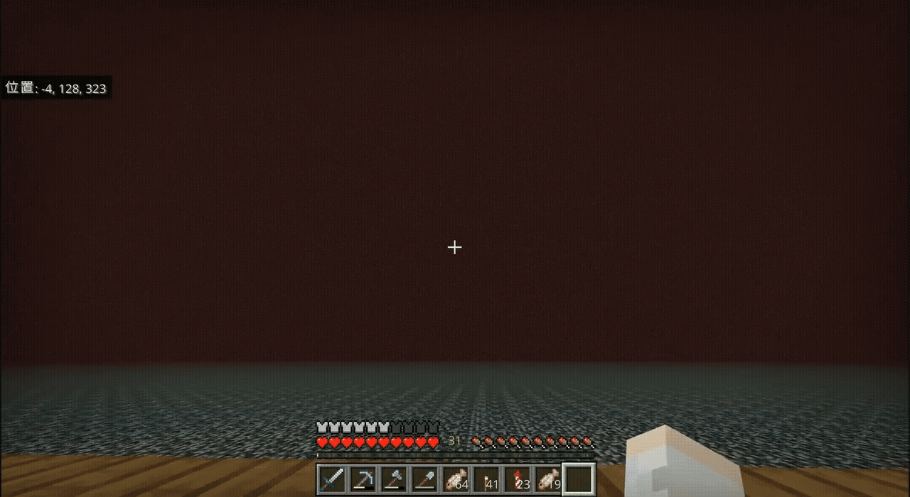
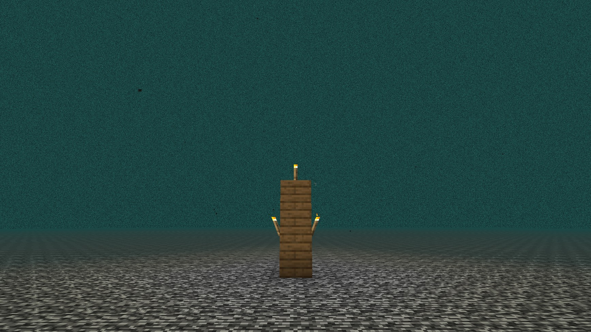

# GeyserSimpleNetherFogFix

> ⚠️ **[Important Notice]**
> This code was created and tested for my own personal environment. Regarding future updates, bug reports, and fix requests, **I may or may not address them when I feel like it** (essentially unmaintained). This is released "as-is" primarily as a personal "memo / backup" or for anyone looking for a similar lightweight solution, so please keep that in mind before using.

**GeyserSimpleNetherFogFix** is a lightweight Geyser extension designed to fix the issue where enabling Geyser's `nether-roof-workaround` forces the entire Nether to be covered in a uniform red fog, restoring **the proper biomespecific fog (vanilla Java-like Nether behavior)**.



---

## ⚠️ Known Issues & Limitations (Trade-offs)

While this plugin successfully restores biome-specific fog and environment colors, **it comes with the following rendering trade-offs:**

* **Distant / Out-of-Range Rendering Glitches ("Gabi-gabi" Pixelation)**
  * A known visual glitch occurs where distant areas or regions outside the normal rendering distance appear jagged and noisy.
  * This is especially noticeable when **looking up into the sky from the Nether roof or scanning wide horizontal views**.
* **Author's Testing & Findings**
  * I attempted various approaches, including texture adjustments, to fix this rendering artifact, but **it is currently unfixable**.
  * Since this appears to be tied to the native rendering specifications of the Geyser and Bedrock clients, please understand and accept this limitation before use.



---

## 🧪 Tested Environments

This plugin has been verified to work in the following environments:

* **Velocity**: `velocity-4.2.0-30`
* **Geyser**: `2.12.1-b1302`
* **Paper**: `paper-1.21.10-127` (Geyser: `2.9.2-b1031`)

*Note: Operation in any other environment is not guaranteed.*

---

## 💡 Background & Design Philosophy

When enabling Geyser's workaround to allow players onto the Nether roof, I was always bothered by the entire Nether being blanketed in a single flat red fog. While looking for a plugin with similar functionality, I couldn't find anything that "simply and solely fixed the Nether fog," so I decided to make it myself.

### 🚀 Performance & Server Load Considerations
To avoid heavy processes like continuously monitoring every player's state every tick (20 times per second), the plugin is built with a **lightweight and efficient design** that won't impact server TPS:
* **Event-Driven (with Delays)**: Clears the fog reliably by introducing configurable millisecond-level delays upon login or immediately after passing through a Nether portal, accounting for client loading lags.
* **Low-Frequency Periodic Check (Safety Net)**: Once the fog is removed, it persists even when moving across biomes. Instead of constant active monitoring, a low-frequency periodic check runs every few to dozens of seconds to ensure consistency.

### Referenced Projects
This plugin extracts and simplifies the core logic used to fix Nether fog from the fantastic extension [GeyserExtras](https://github.com/letsgoaway/GeyserExtras) (and its derivative ecosystem). Deepest thanks to the developers who open-sourced such wonderful base code.

### 🛠️ Processing Overview & Technical Notes
Technical notes to help trace and fix the original code if it ever breaks due to future updates in Geyser or dependencies.

* **Reference Source**: `GeyserExtras 2.0.0-BETA-11`
* **Target File**: `core/src/main/java/dev/letsgoaway/geyserextras/core/ExtrasPlayer.java` (lines 216–218)

Extracted and streamlined the following core logic:

```java
if (session.getDimensionType().isNetherLike() && session.camera().fogEffects().contains(DimensionUtils.BEDROCK_FOG_HELL)) {
    session.camera().removeFog(DimensionUtils.BEDROCK_FOG_HELL);
}
```

---

## 📥 Installation
1. Download `GeyserSimpleNetherFogFix-x.x.x.jar` from the release/build directory.
2. Place the downloaded file into your Geyser extensions folder (`extensions/`).
3. Start your server or reload/restart Geyser.

---

## 🤖 Note on Development
The code for this plugin was created with the support of AI (Gemini). While I have basic programming knowledge, writing code completely from scratch is difficult, so I am very grateful for the AI's assistance.

---

## 📢 Reason for Public Release
I decided to publish this because I wanted to share it with anyone who has the same frustration—"I want to enable building on the Nether roof, but I can't stand that single red fog covering everything..."—as well as to serve as a personal development and maintenance memo. I hope it helps other server administrators facing the same issue.

---
